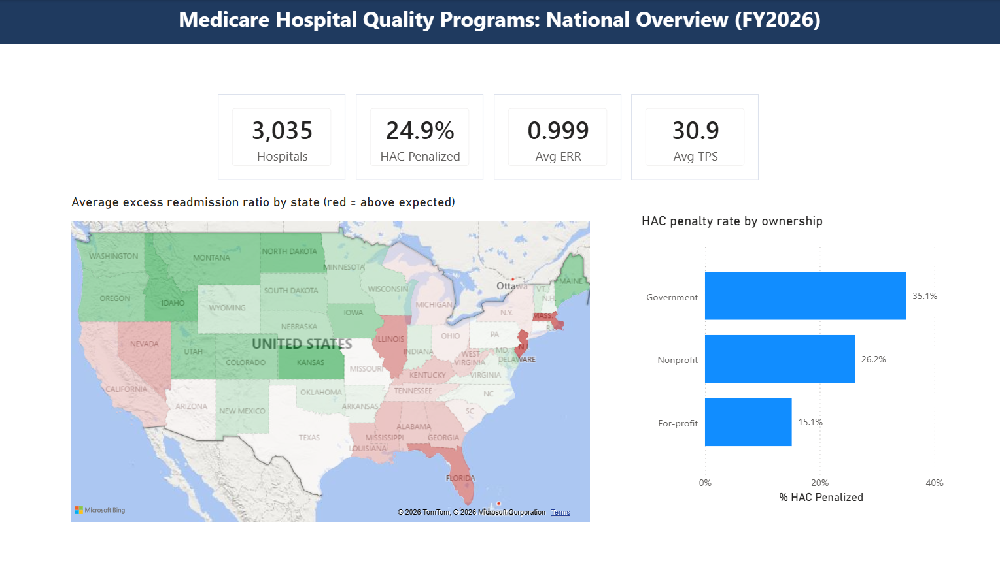
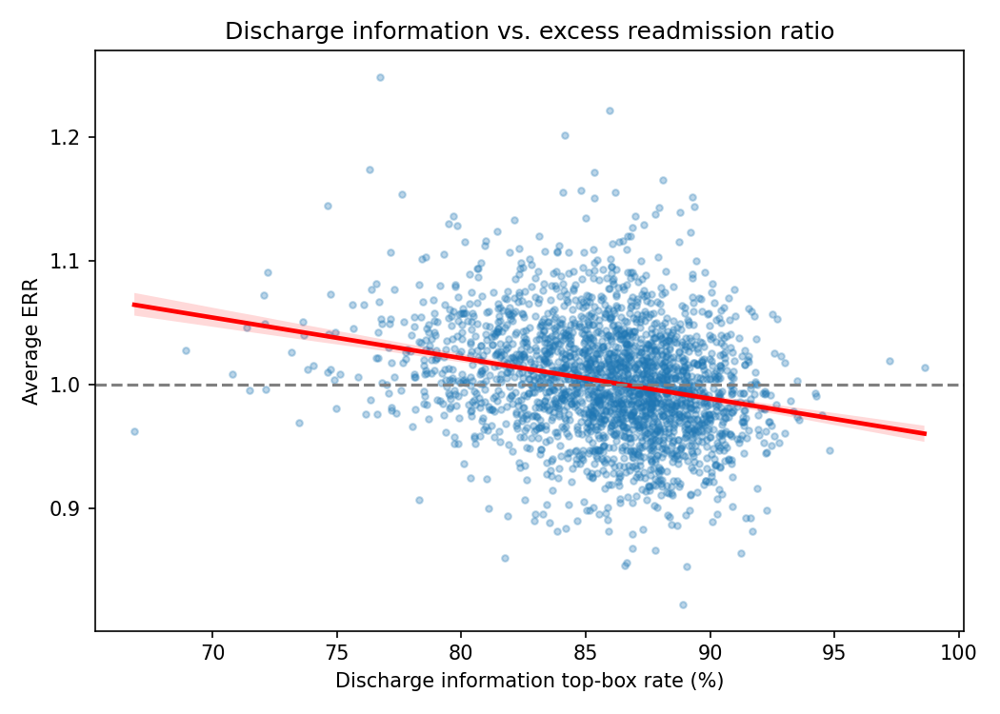
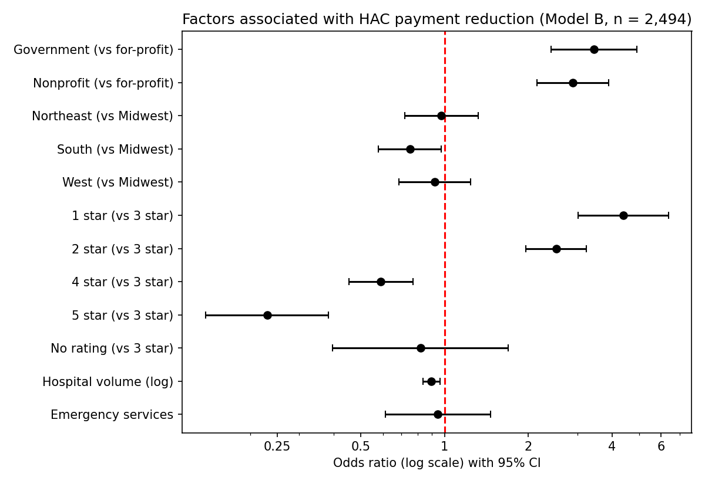
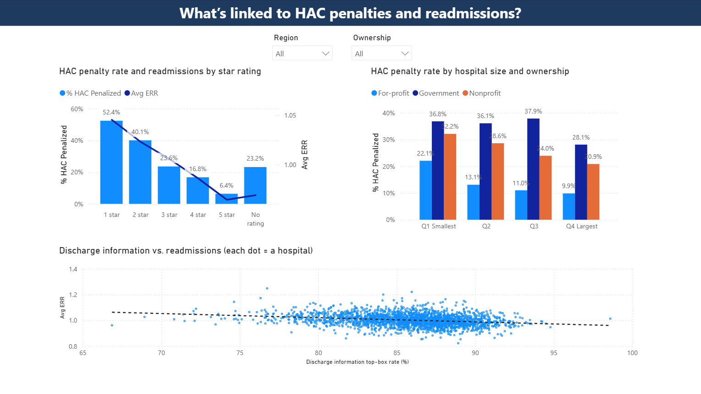
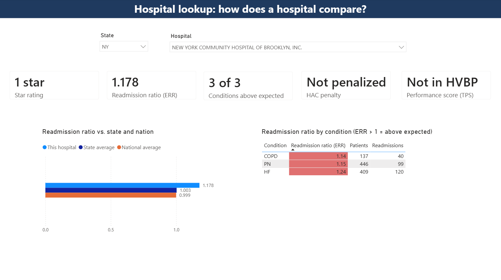

# CMS Hospital Quality Analysis

**Which U.S. hospitals get penalized by Medicare, and why?**

An end-to-end analysis of three Medicare pay-for-performance programs for **3,035 U.S. acute care hospitals** using FY2026 CMS data, built with **SQL Server, Python, and Power BI**.



---

## Key Findings

1. **Ownership is strongly linked to safety penalties.** Government hospitals were penalized under the HAC program more than twice as often as for-profit hospitals (35.1% vs. 15.1%). In logistic regression, government hospitals had about **3× the odds** of a penalty (OR = 3.09, 95% CI 2.20–4.33), and the gap remained after controlling for hospital size, region, and star rating.
2. **Better discharge communication goes with fewer readmissions.** Hospitals with higher discharge-information scores had lower excess readmission ratios (Spearman ρ = −0.27, p < 0.001). After adjustment, each 10-point increase in the score was associated with about **3% fewer readmissions than expected**.
3. **Smaller hospitals are penalized more often, not less.** HAC penalty rates fell from 30.5% in the smallest volume quartile to 20.4% in the largest.
4. **Readmission and safety programs measure different things.** States and regions that ranked high on readmissions did not rank high on safety penalties (e.g., New Jersey had the highest readmission ratio but only 8.2% of its hospitals were penalized under HAC).
5. **About 1 in 10 hospitals (10.4%) were weak on both programs**, facing penalties from two Medicare programs at once.

---

## Background

Medicare adjusts hospital payments based on quality through three programs:

| Program | What it measures | Payment impact |
|---|---|---|
| **HRRP**: Hospital Readmissions Reduction Program | 30-day readmissions for 6 conditions (AMI, heart failure, pneumonia, COPD, CABG, hip/knee replacement) | Up to 3% reduction |
| **HAC**: Hospital-Acquired Condition Reduction Program | Infections and patient-safety events | 1% reduction for the worst-performing quartile |
| **HVBP**: Hospital Value-Based Purchasing | Total Performance Score across clinical outcomes, safety, patient experience, and efficiency | Bonus or reduction |

**Key measure: Excess Readmission Ratio (ERR)** = a hospital's predicted readmission rate ÷ the rate expected for an average hospital with similar patients. ERR > 1 means more readmissions than expected.

## Research Questions

1. **RQ1 (Describe):** How do readmissions, safety penalties, and performance scores differ by state, region, ownership, and hospital size?
2. **RQ2 (Relate):** Do hospitals with better patient experience have fewer excess readmissions?
3. **RQ3 (Predict):** Which hospital characteristics are associated with receiving a HAC payment reduction?

---

## Data

Source: [CMS Provider Data Catalog](https://data.cms.gov/provider-data/), downloaded October 2026. Readmission measurement period: July 1, 2021 – June 30, 2024.

| File | Rows | Level |
|---|---|---|
| Hospital_General_Information.csv | 5,419 | Hospital |
| FY_2026_Hospital_Readmissions_Reduction_Program_Hospital.csv | 18,330 | Hospital × condition |
| FY_2026_HAC_Reduction_Program_Hospital.csv | 3,055 | Hospital |
| hvbp_tps.csv | 2,455 | Hospital |
| hvbp_person_and_community_engagement.csv | 2,455 | Hospital |

**Analysis population:** 3,035 acute care hospitals participating in HRRP and HAC. Other hospital types (critical access, psychiatric, children's, VA, military) are excluded from these programs by law. Raw files are not included in this repository; download them from the link above.

---

## Methods

```
Raw CSVs → SQL Server (load, clean, validate) → analysis view (1 row per hospital)
        → SQL analysis queries → Python statistics → Power BI dashboard
```

| Step | Tools | File |
|---|---|---|
| Load and validate | SQL Server | [`SQL/01_load_check.sql`](SQL/01_load_check.sql) |
| Clean, pivot, primary keys, analysis view | SQL Server (CTEs, `TRY_CAST`, pivoting) | [`SQL/02_clean.sql`](SQL/02_clean.sql) |
| Descriptive and stratified analysis | SQL Server (window functions: `NTILE`, `RANK`, `ROW_NUMBER`) | [`SQL/03_analysis.sql`](SQL/03_analysis.sql) |
| Statistical analysis | Python (pandas, SciPy, statsmodels, seaborn) | [`Notebooks/analysis.ipynb`](Notebooks/analysis.ipynb) |
| Interactive dashboard | Power BI (DAX measures, calculated columns, relationships) | [`Power BI/`](Power%20BI/) |

**Statistical methods:** Spearman correlation; OLS regression with heteroskedasticity-robust (HC3) standard errors; logistic regression reported as odds ratios with 95% confidence intervals; stratified analysis by volume quartile.

---

## Results

### RQ1: Differences by hospital characteristics

**HAC penalty rate by ownership** (hospitals with a HAC score)

| Ownership | Hospitals | % HAC penalized | Avg ERR |
|---|---|---|---|
| Government | 432 | **35.1%** | 1.001 |
| Nonprofit | 1,914 | 26.2% | 0.998 |
| For-profit | 689 | **15.1%** | 1.004 |

- **The ownership gap holds within every size group.** In the largest volume quartile: Government 28.1%, Nonprofit 20.9%, For-profit 9.9%.
- **Region:** Northeast (ERR 1.007) and Southern hospitals (1.005) had more readmissions than expected; Midwest (0.993) and Western hospitals (0.991) had fewer.
- **States:** highest readmission ratios in New Jersey (1.029), Massachusetts (1.028), and Florida (1.022); lowest in Idaho (0.940), Kansas (0.946), and Montana (0.957).
- **Star ratings aligned with all programs:** 1-star hospitals had a 52.4% HAC penalty rate vs. 6.4% for 5-star hospitals, and ERR fell from 1.045 to 0.964. Because star ratings include readmission and safety measures, this partly reflects overlapping measures.
- ERR is centered on 1 by design (about 48% of hospitals were above expected for every condition), so the analysis compares hospital groups rather than conditions.

### RQ2: Patient experience and readmissions



| Patient experience measure | Spearman ρ | p |
|---|---|---|
| Discharge information | **−0.27** | < 0.001 |
| Care transition | −0.21 | < 0.001 |
| Overall HCAHPS score | −0.19 | < 0.001 |

*n = 2,383 hospitals*

- Average ERR fell steadily across discharge-information quartiles: **1.018 → 1.008 → 0.996 → 0.988**.
- **Adjusted model (OLS, n = 2,248):** each 1-point increase in discharge information score was associated with a 0.003 lower ERR (95% CI −0.004 to −0.002, p < 0.001), controlling for ownership, region, and volume. R² = 0.086, so patient experience is one of several factors. Results were unchanged with robust (HC3) standard errors.

### RQ3: Predictors of HAC penalties



Logistic regression, n = 2,494 hospitals (620 penalized). Reference groups: For-profit, Midwest, 3-star.

| Variable | Model A: OR (95% CI) | Model B (+ star rating): OR (95% CI) |
|---|---|---|
| Government | **3.09** (2.20–4.33) | **3.44** (2.41–4.92) |
| Nonprofit | **1.95** (1.47–2.57) | **2.89** (2.14–3.89) |
| Hospital volume (log) | **0.89** (0.84–0.95) | **0.90** (0.84–0.96) |
| 1 star | – | **4.39** (3.02–6.39) |
| 5 star | – | **0.23** (0.14–0.38) |
| Region, emergency services | not significant | not significant (South borderline) |
| Pseudo R² | 0.023 | 0.108 |

- **The ownership effect strengthened after adding star ratings.** Nonprofit hospitals had higher star ratings than for-profits (45% vs. 24% rated 4–5 stars) yet more HAC penalties, a suppression effect. The higher penalty rates of government and nonprofit hospitals are therefore not explained by lower overall quality ratings.
- Possible explanations to explore in future work: differences in patient mix, infection surveillance and reporting intensity, and hospital resources.

---

## Dashboard

A 3-page interactive Power BI dashboard ([`Power BI/CMS_Hospital_Dashboard.pbix`](Power%20BI/)):

| Page | Contents |
|---|---|
| **National overview** | KPI cards, state map of readmission ratios, HAC penalty rate by ownership |
| **What's linked to penalties** | Star ratings, size × ownership (stratified), discharge information scatter; region and ownership slicers |
| **Hospital lookup** | Searchable hospital selector; hospital vs. state vs. national comparison; condition-level readmission table with conditional formatting |




---

## Data Quality Notes

Issues found during validation and how they were handled:

- **Hospitals without readmission data (222):** originally counted as "0 conditions above expected"; corrected to NULL so they are not treated as good performers.
- **Hidden characters in HRRP condition names:** broke the condition pivot; removed during cleaning.
- **125 hospitals without a Total HAC Score** (CMS footnote 5) were listed as "not penalized"; excluded from penalty analyses. Among the 2,886 scored hospitals, 24.9% were penalized, consistent with CMS's worst-quartile rule.
- **Maryland hospitals (43)** have no HAC payment decision because Maryland operates under its own all-payer model.
- **20 HRRP/HAC hospitals** were not in the General Information file and were excluded.

## Limitations

- Cross-sectional, observational data: findings show **associations, not causation**.
- ERR is a risk-adjusted model estimate; social risk factors (income, housing, access to follow-up care) are not fully captured.
- Hospital volume is approximated by total discharges across the six HRRP conditions, not bed count.
- Missing data: 12.6% of hospitals lack a star rating, 20.4% lack HCAHPS scores, and infection measures are missing for 9–32% of hospitals.
- Programs use different measurement periods.
- Teaching status and safety-net status are not available in these files.

---

## How to Reproduce

1. Download the five files from the CMS Provider Data Catalog into `Raw Data/`.
2. In SQL Server, create a database `CMS_Hospital` and import each file as a raw table with all columns as text (`raw_general`, `raw_hrrp`, `raw_hac`, `raw_tps`, `raw_hcahps`).
3. Run `SQL/01_load_check.sql`, `SQL/02_clean.sql`, and `SQL/03_analysis.sql` in order.
4. Export `v_hospital_analysis` (where `in_hrrp = 1`) as tab-delimited text to `Data Processed/hospital_analysis.txt`.
5. Run `Notebooks/analysis.ipynb`.
6. Open `Power BI/CMS_Hospital_Dashboard.pbix` and update the server name in the data source settings.

## Repository Structure

```
├── SQL/                  # Load, clean, and analysis scripts
├── Notebooks/            # Python statistical analysis
├── Reports/              # Figures and dashboard screenshots
├── Power BI/             # Interactive dashboard (.pbix)
├── data_dictionary.xlsx  # Column definitions
└── README.md
```

---

**Author:** Nur Vanu · [LinkedIn](https://www.linkedin.com/in/nur-vanu-88828a194/)

